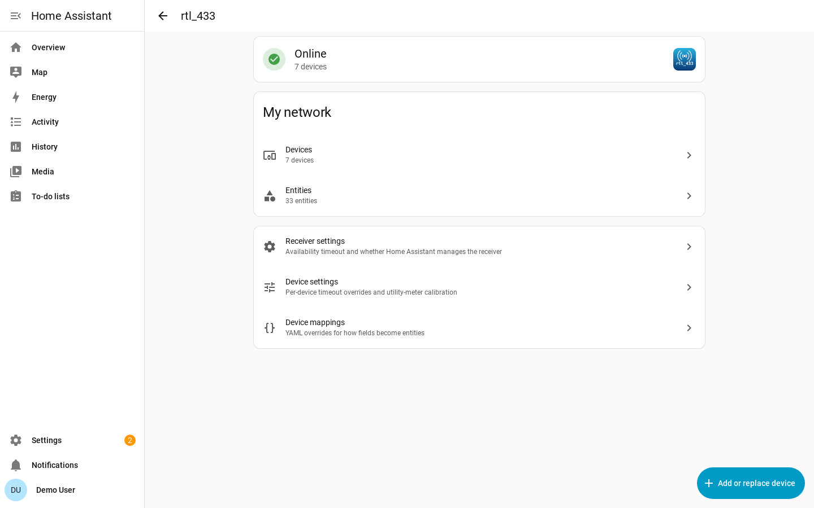
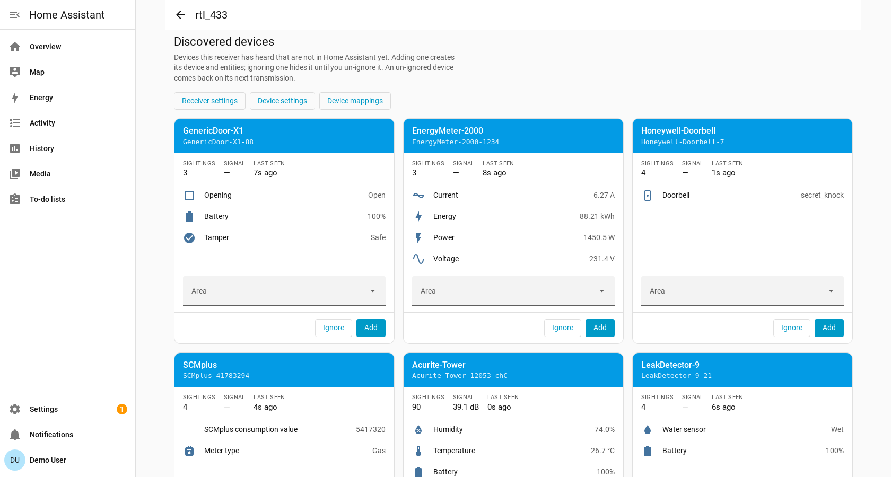

# Getting started

Follow this guide to bring your first wireless sensor into Home Assistant using
a USB RTL-SDR radio and the rtl_433 add-on. Start with the integration, restart
Home Assistant, then start the add-on so Home Assistant can discover your radio.

## Understand the two parts

The **add-on** runs your radio receiver and decodes wireless sensor messages.
The **integration** turns those messages into Home Assistant devices and
entities. For this setup, you install both.

Home Assistant now calls add-ons **apps**. We use “add-on” for this project's
receiver software; you will install it through Home Assistant's app store.

| Component | Where its repository goes | What it does |
| --- | --- | --- |
| **Integration** | **HACS → ⋮ → Custom repositories**, type **Integration** | Creates Home Assistant devices and entities from decoded messages. |
| **Add-on (app)** | **Settings → Apps → Install app → ⋮ → Repositories** | Runs the radio and decodes messages. |

A **repository** tells the relevant store where to find the software. Adding a
repository makes it available to install; you must then download or install it.
The two stores use different repository URLs, shown in the steps below.
Use each URL in its matching store: HACS takes the integration repository,
and the app store takes the add-on repository.

The Python library mentioned elsewhere on this site is installed automatically
with the integration. You do not need to install it separately.

## 1. Check what you need

- **Home Assistant OS**, with administrator access. This guide uses its app
  store. If you use Home Assistant Container or an external receiver, see
  [Other setups](#other-setups).
- **A Home Assistant version supported by the integration.** The current
  integration declares a minimum of **2026.9.0**. Check your version under
  **Settings → About** and the
  [integration's current requirements](https://github.com/rtl-433-hass/rtl_433/blob/main/hacs.json)
  before downloading a release.
- **HACS installed and configured.** HACS is the Home Assistant Community Store
  for custom integrations. If you have not set it up, follow the
  [official HACS getting started instructions](https://www.hacs.xyz/docs/use/),
  including its initial configuration, then return here.
- **A supported USB RTL-SDR radio and antenna**, connected to the machine
  running Home Assistant. For a virtual machine, pass the USB radio through to
  the Home Assistant VM.
- **A wireless sensor supported by rtl_433**, and its transmitting frequency.
  See the [hardware guide](https://triq.org/rtl_433/HARDWARE.html) and
  [supported protocols](https://github.com/merbanan/rtl_433/blob/master/README.md).
  Receiver decoding support and the integration's mapping of readings to
  entities are separate; some devices may need additional mappings.

**Checkpoint:** You can open **HACS** from Home Assistant's sidebar and
**Apps** from Settings, and you know your sensor's frequency.

## 2. Install the integration through HACS

Open **HACS in the Home Assistant sidebar**. Use its custom repository dialog
for this URL:

```text
https://github.com/rtl-433-hass/rtl_433
```

1. In HACS, select the **⋮** menu in the top right.
2. Select **Custom repositories**.
3. Paste the URL above into **Repository**.
4. Select **Integration** as the repository type (called **Category** in some
   HACS versions).
5. Select **Add**, then close the custom repository dialog.
6. Search HACS for **rtl_433**. Open its entry and select **Download**, confirming
   the download if prompted. Use the stable release offered by HACS.

For screenshots of the menu and dialog, see
[HACS: Custom repositories](https://www.hacs.xyz/docs/faq/custom_repositories/).
Use our integration URL above when following those examples.

**Checkpoint:** HACS shows **rtl_433** as downloaded or pending restart. Adding
the repository alone does not complete this step.

## 3. Restart Home Assistant

Restart **Home Assistant**, using the restart action under
**Settings → System → ⋮ → Restart Home Assistant**. Wait until the interface
is available again.

The restart loads the integration. It must be loaded before the add-on starts
to receive the radio's automatic discovery information.

**Checkpoint:** Home Assistant is available again, and HACS no longer shows
rtl_433 as pending restart. You will add the receiver in step 6.

## 4. Add the app repository and install the add-on

Open **Settings → Apps → Install app** to reach the app store. This time, use
the **app store's repository dialog** for this different URL:

```text
https://github.com/rtl-433-hass/rtl_433-hass-addons
```

1. In the app store, select the **⋮** menu in the top right.
2. Select **Repositories**.
3. Paste the URL above and select **Add**.
4. Close the dialog to return to the app store. Refresh the page if the new
   repository is not visible yet.
5. Find **rtl_433** in the new repository's entries, open it, and select
   **Install**. Wait for installation to finish.

Choose **rtl_433**, the stable add-on. **rtl_433 (next)** is a development build
for testing unreleased changes.

For screenshots of this separate repository dialog, see
[Home Assistant: Installing a third-party app repository](https://www.home-assistant.io/common-tasks/os/#installing-a-third-party-app-repository).
Use our add-on URL above instead of the example repository.

**Checkpoint:** The installed rtl_433 app has an information page with a
**Start** button. It is separate from the rtl_433 entry you downloaded in HACS.

## 5. Connect the radio and start the add-on

1. Connect your USB RTL-SDR radio and antenna to the Home Assistant host.
2. On the rtl_433 app's information page, select **Start**.
3. Open its **Log** tab and check that a radio was detected and started.
4. Enable **Start on boot** if you want the receiver to start automatically
   when Home Assistant boots.

For the usual USB RTL-SDR setup, you can leave the add-on options at their
defaults. The default receiver frequency is **433.92 MHz**; other sensor bands
need a frequency change after connecting the receiver in the next step.

**Checkpoint:** The add-on is running and its log shows a detected radio.
If it does not, see [No receiver card appears](#no-receiver-card-appears).

## 6. Add the discovered receiver

1. Open **Settings → Devices & Services**.
2. Find the discovered **rtl_433** card for your radio.
3. Select **Add** and confirm the setup.

Home Assistant learns the connection details automatically. A **receiver**
(also called a **hub** in the reference docs) represents one radio; its wireless
sensors will appear beneath it after you add them.

**Checkpoint:** rtl_433 is configured under Devices & Services, with a receiver
device. A receiver being added does not automatically add the sensors it hears.

### If your sensor uses another frequency

For a single-frequency receiver, open its device page from the rtl_433
integration and find the **Center frequency** control in its configuration
entities. Set it to your sensor's frequency in **MHz**, for example **315**,
**868**, or **915**, using the exact value specified by the sensor manufacturer.
These controls are available when **Manage rtl_433 settings from Home
Assistant** is enabled, as it is by default.

A receiver listens to the frequency it is tuned to; it does not listen to all
four bands at once. For multiple frequencies or radios, see
[Receiver settings](https://rtl-433-hass.github.io/rtl_433/latest/hub-entities/#managing-sdr-settings-from-home-assistant)
and [Add-on configuration](https://rtl-433-hass.github.io/rtl_433-hass-addons/latest/configuration/).

## 7. Add your first sensor

1. Open **Settings → Devices & Services → rtl_433 → Configure** (the gear icon).
2. On the rtl_433 page, select **Add or replace device**.
3. Wait for your sensor to transmit. For a doorbell, remote, door contact, or
   motion sensor, trigger it once. Periodic sensors may take several minutes.
4. Find your sensor in the discovered devices. Check its model and latest
   readings; triggering it again can help confirm which card is yours.
5. Choose an **Area** if desired, then select **Add** on the sensor's card.

The screenshots below show an example setup with devices already added; your
overview starts with no sensor devices.

<!-- Screenshots reused from rtl-433-hass/rtl_433 docs/images:
     18-rtl-433-page.png and 17-discovery-panel.png. -->





The receiver may also hear neighbours' devices. Add only the sensors you want;
use **Ignore** for unwanted devices. Sensors are never added automatically.

**Checkpoint:** Your sensor's card turns green and links to its Home Assistant
device page.

## 8. Check your readings

Open the newly added device. Confirm that it has the expected entities, such as
temperature and humidity. Wait for another transmission, or trigger the sensor
again, and check that readings or its **Last seen** timestamp update.

**Setup is complete when your sensor's device and readings update in Home
Assistant.** For doorbells and remotes, see
[Event-based devices](https://rtl-433-hass.github.io/rtl_433/latest/event-based-devices/)
to use their events in automations.

## If you get stuck

### HACS is missing

Complete both the download and initial configuration in the
[HACS setup guide](https://www.hacs.xyz/docs/use/). Return to step 2 once you
can open HACS from Home Assistant's sidebar.

### The repository or software is missing

- In **HACS**, use the URL ending in **`/rtl_433`** and type **Integration**.
  Select **Add**, close the dialog, and search for rtl_433. Clear search filters
  that might hide an integration available to download.
- In the **app store**, use the URL ending in **`/rtl_433-hass-addons`**. Select
  **Add**, close the dialog, and refresh the store.
- If either dialog reports an error, confirm you pasted the complete GitHub
  repository URL from the relevant step, rather than this documentation URL.

### No receiver card appears

1. Confirm that HACS downloaded the integration and that you restarted Home
   Assistant afterward.
2. Restart the **rtl_433 add-on** so it sends its discovery information again.
3. Check **Settings → Devices & Services** for the discovered card.
4. If it is still missing, check the add-on log for a detected radio and any
   startup errors. For a VM, verify USB passthrough; also check that another
   program or add-on is not already using the radio.

If the radio is running but discovery still fails, follow the
[manual connection instructions](https://rtl-433-hass.github.io/rtl_433-hass-addons/latest/installation/#connect-home-assistant),
using the radio's host and port from the log.

### The receiver is online, but no sensor appears

- Confirm the sensor has power and trigger it, or wait for its next transmission.
- Check that the receiver frequency matches the sensor and that its antenna is
  connected. Try bringing the sensor closer to the receiver.
- Temporarily enable **log_received_messages** on the add-on's Configuration
  tab, save, and restart the add-on if prompted. Its log can then show whether
  rtl_433 is decoding the sensor. Turn this option off again after checking.
- Reopen **Configure → Add or replace device**. Seeing a receiver under
  Devices & Services is only the receiver setup; you still need to add the sensor.
- If messages are decoded but the expected readings are missing, consult the
  [device mapping guide](https://rtl-433-hass.github.io/rtl_433/latest/device-library/)
  and [diagnostics](https://rtl-433-hass.github.io/rtl_433/latest/diagnostics/).

## Other setups

- **Home Assistant Container or an existing rtl_433 server:** install the
  integration through HACS as in steps 2–3, enable HTTP output on your server,
  and [add a hub manually](https://rtl-433-hass.github.io/rtl_433/latest/configuration/#manual-configuration).
  Then continue at step 7 to add sensors.
- **Manual integration installation:** follow the
  [manual install guide](https://rtl-433-hass.github.io/rtl_433/latest/installation/#manual-install),
  restart Home Assistant, and continue at step 4 if using the add-on.
- **Multiple radios:** the add-on discovers each supported USB RTL-SDR radio.
  Add each discovered receiver, then choose sensors as in step 7.
- **Other radio hardware or development builds:** see the
  [add-on's advanced topics](https://rtl-433-hass.github.io/rtl_433-hass-addons/latest/advanced/)
  and [development add-on instructions](https://rtl-433-hass.github.io/rtl_433-hass-addons/latest/installation/#development-add-on).
